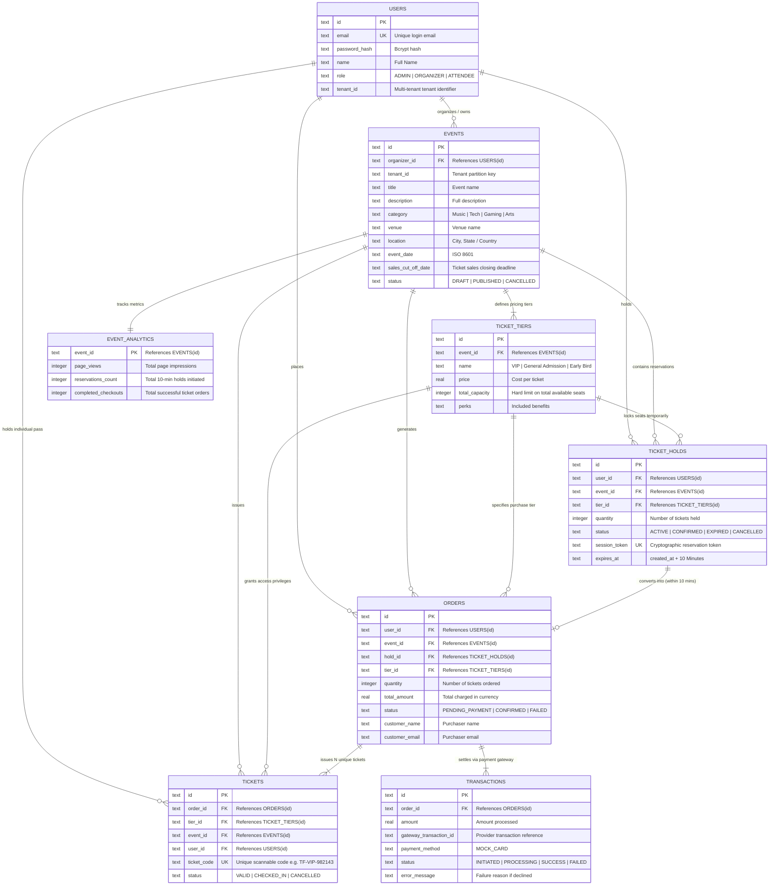

# TicketFlow — Multi-Tenant Event & Ticket Reservation System

[](https://nodejs.org/)
[](https://www.postgresql.org/)
[](https://redis.io/)
[]()
[]()

> A production-grade multi-tenant event ticketing platform featuring **Role-Based Access Control (RBAC)**, a **10-minute temporary reservation hold engine**, **atomic concurrency locking** to eliminate double-booking, **Redis caching**, **asynchronous payment simulation**, and **real-time analytics dashboards**.

---

## 📋 Evaluation Deliverables Checklist

| Deliverable Required | Location in Repo | Description |
| :--- | :--- | :--- |
| **1. ER Diagram & Data Model** | [Section Below](#-entity-relationship-er-diagram) & [`docs/ERD.md`](docs/ERD.md) | Visual Mermaid schema of Users, Events, Tiers, Holds, Orders, Tickets, Transactions. |
| **2. Postman Collection** | [`postman/Multi-Tenant-Event-Ticket-System.postman_collection.json`](postman/Multi-Tenant-Event-Ticket-System.postman_collection.json) | 8 test folders with edge cases (409 Conflict, 410 Expired Hold, Webhooks, RBAC). |
| **3. Concurrency Stress Test** | [`tests/concurrency-test.js`](tests/concurrency-test.js) | 50 simultaneous parallel requests tested on 5 seats — 0 double bookings verified. |
| **4. Cloud Deployment Setup** | [`render.yaml`](render.yaml), [`docker-compose.yml`](docker-compose.yml), [`docs/DEPLOYMENT.md`](docs/DEPLOYMENT.md) | Ready for 1-click deployment on Render, Railway, or Docker. |

---

## 🔑 Demo Access & Live Credentials

Use the **1-Click Role Switcher** buttons in the navigation bar to test all three roles:

| Role | Email | Password | Primary Capabilities |
| :--- | :--- | :--- | :--- |
| **Attendee** | `attendee@user.com` | `attendeepass123` | Select tiers, lock seats for 10 minutes with live countdown, complete mock payment, print scannable ticket vouchers. |
| **Organizer** | `organizer@musicfest.com` | `organizerpass123` | Create multi-tier events, set capacities & cut-off dates, view live revenue charts & conversion funnels. |
| **Admin** | `admin@ticketflow.com` | `adminpassword123` | Platform oversight, monitor Redis cache and background cron status, trigger manual expired hold sweeps. |

---

## 📊 Entity-Relationship (ER) Diagram

GitHub renders this diagram natively:



---

## 🔒 Concurrency Invariant & Double-Booking Prevention

### The Math Invariant
For any ticket tier $T$ at any given timestamp $t$:

$$\text{SoldTickets}(T) + \text{ActiveUnexpiredHolds}(T, t) \le \text{TotalCapacity}(T)$$

### Prevention Strategy
1. **Per-Tier Distributed / Atomic Mutex Lock**:
   - Acquire `lock:tier:{tierId}` using Redis `SET key token NX PX 5000` (or high-speed memory mutex).
2. **Atomic Write Transaction**:
   - In PostgreSQL: `SELECT * FROM ticket_tiers WHERE id = $1 FOR UPDATE`
   - In SQLite: `BEGIN IMMEDIATE` (enforces serialized write locking in WAL mode).
3. **Availability Validation**:
   - Available capacity is calculated as:
     $$\text{Available} = \text{total\_capacity} - (\text{valid\_sold} + \text{active\_holds})$$
   - If $\text{requested\_qty} > \text{Available}$, the transaction aborts with **HTTP 409 Conflict**.
   - If sufficient, insert hold with `expires_at = now() + 10 minutes`.
4. **Automatic Hold Release Worker**:
   - Background worker runs every 15 seconds:
     ```sql
     UPDATE ticket_holds SET status = 'EXPIRED' WHERE status = 'ACTIVE' AND expires_at <= NOW()
     ```
   - Invalidates Redis cache, returning seats to the available pool instantly.

---

## 🧪 Concurrency Stress Test Results

Run the automated concurrency stress test:
```bash
npm run test:concurrency
```

### Verified Test Output:
```text
====================================================
🧪 RUNNING CONCURRENCY & DOUBLE-BOOKING STRESS TEST
====================================================
[Setup] Created test tier with strict total_capacity = 5
[Stress Test] Firing 50 simultaneous booking requests for 1 ticket each...

📊 Concurrency Results:
   ✅ Successful holds: 5
   🚫 Blocked by lock/capacity (409 Conflict): 45
   ⚠️ Unexpected errors: 0

🎯 CONCURRENCY SAFETY VERIFIED: ZERO DOUBLE-BOOKINGS OCCURRED!

💳 Testing Checkout of a valid active hold...
   ✅ Order confirmed with ticket code: TF-ULT-2AE636-2PA9

⏳ Testing Expired Hold Edge Case...
   🧹 Worker sweep released: 1 expired holds.
   ✅ Correctly rejected checkout on expired hold: HTTP 410 Gone

🔄 Testing Re-reservation of Released Capacity...
   ✅ Successfully reserved freed ticket with new hold ID!
```

---

## 🚀 Quick Start (Local Setup)

Runs with zero external dependencies (Node.js v22+ built-in SQLite & in-memory cache fallback):

```bash
# 1. Clone repository
git clone <your-repo-url>
cd event-ticket-reservation-system

# 2. Install dependencies
npm install

# 3. Build frontend
npm run build:client

# 4. Start Server
npm start
```

Visit: **`http://localhost:5000`**

To run tests:
```bash
npm test
```

---

## 📬 Postman API Collection

Import the included file into Postman:  
📂 **`postman/Multi-Tenant-Event-Ticket-System.postman_collection.json`**

### Pre-Configured Test Folders:
1. **`01. Authentication & RBAC`**: Admin, Organizer, Attendee logins, token injection.
2. **`02. Event Management`**: Create event with tiers, list cached events, 403 Attendee guard.
3. **`03. Reservation Engine`**: Place 10-minute hold, verify live countdown.
4. **`04. Concurrency & Edge Cases`**:
   - Exceed capacity $\rightarrow$ `409 Conflict`
   - Checkout expired hold $\rightarrow$ `410 Gone`
   - Non-existent hold $\rightarrow$ `404 Not Found`
5. **`05. Payment Simulation`**:
   - Card ending in `4242` $\rightarrow$ `201 Approved`
   - Card ending in `0002` $\rightarrow$ `402 Declined`
   - Asynchronous delay & Webhook callbacks
6. **`06. Attendee Experience`**: View my bookings & scannable QR ticket codes.
7. **`07. Analytics Dashboard`**: Organizer revenue breakdown, conversion rate.
8. **`08. Admin Platform Controls`**: Infrastructure stats, tenant volume, manual hold sweep.

---

## ☁️ Cloud Deployment

Detailed step-by-step instructions are in [`docs/DEPLOYMENT.md`](docs/DEPLOYMENT.md).

### Option 1: Render (1-Click Blueprint)
1. Fork or push this repository to GitHub.
2. Go to **Render Dashboard** $\rightarrow$ **New +** $\rightarrow$ **Blueprint**.
3. Select this repository. Render automatically reads [`render.yaml`](render.yaml) and provisions:
   - Web service (`Node.js`)
   - PostgreSQL 16 database
   - Redis service
4. Click **Apply**.

### Option 2: Railway
1. Create new project from GitHub repo.
2. Add PostgreSQL and Redis plugins.
3. Railway auto-detects [`railway.json`](railway.json) and [`Procfile`](Procfile) and deploys.

### Option 3: Docker Compose
```bash
docker compose up -d --build
```
Runs Web App on port `5000`, PostgreSQL on `5432`, and Redis on `6379`.

---

## 🛡️ License
MIT License. Created for the Multi-Tenant Event & Ticket Reservation System assignment.

